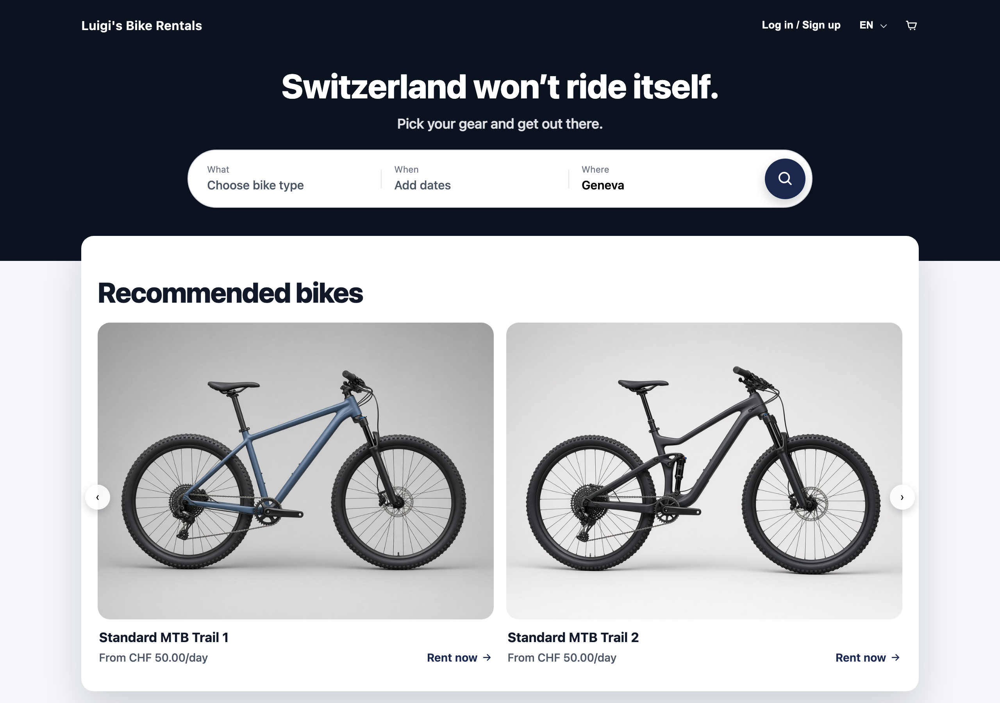
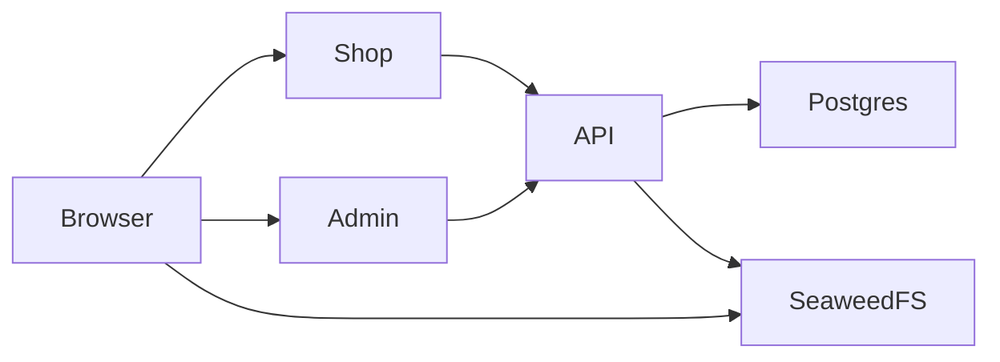

# luigi

White-label software for a rental shop. The demo shop rents bikes. One deployment is one shop.

The shop is running at https://luigisrental.de/en. How that server is updated is in [DEPLOYMENT.md](DEPLOYMENT.md).

## Why

- Learn Go and concurrency.
- Build the frontend with Next.js.
- Find out how much you have to think about in a full-stack project, and how to build the architecture and the deployment.
- Figure out how to use AI to improve my skills: its strengths, its weaknesses, and what to watch out for.
- Make a product I can stand behind, using AI mostly as a tool to teach me, write boilerplate, review, and do the frontend styling.

## What it consists of

- **Shop** (`luigi-mvp/web-shop`). The customer site: catalog, cart, checkout, reservations. Next.js. English, German, French, and Italian.
- **Admin** (`luigi-mvp/web-admin`). The staff site: users, stores, the reservation desk, financials. Next.js.
- **API** (`luigi-mvp/api`). Go. Auth, catalog, availability, cart, checkout, reservations, invoices, image upload.
- **Postgres**. The database. Schema changes go through goose. Queries are generated with sqlc.
- **SeaweedFS**. Image storage, spoken to over S3. The browser loads images from it. Upload and delete go through the API.

Login is email and password. The API stores an argon2id hash and a session row in Postgres, and sets an HttpOnly cookie. Guests get a separate cookie so a cart can exist before signup.

A lot of shop and admin behavior is still unfinished. [IMPROVEMENTS.md](IMPROVEMENTS.md) is the list.

## A look at it

The shop home. Search by bike, dates, and store, then the catalog.



The same deployment, live:

- [Shop](https://luigisrental.de/en)
- [A product](https://luigisrental.de/en/products/1)
- [Checkout](https://luigisrental.de/en/checkout)
- [Admin](https://admin.luigisrental.de/en)

## Styles

Typography, color, spacing, and the shared controls are on the [styles page](https://luigisrental.de/en/components). The tokens are CSS variables in `luigi-mvp/web-shop/app/[locale]/globals.css`.

## Architecture

The shop and the admin never talk to the database. They call the API. The API is the only writer to Postgres and to the bucket.



On a laptop, Postgres, migrations, a seeded admin, the API, and SeaweedFS run in Docker. The two Next.js apps stay on the host so `pnpm dev` stays fast.

On a server, [`luigi-mvp/docker-compose.yml`](luigi-mvp/docker-compose.yml) runs the same pieces as images, plus Caddy for TLS. Shop, admin, and media each have a domain. The differences from the laptop are environment variables, not a second codebase.

## Setup

You need Go, Node, pnpm, and Docker. The longer notes, including a reset and running the API on the host, are in [LOCAL.md](LOCAL.md).

From `luigi-mvp/`:

```
cp .env.example .env
cp web-shop/.env.example web-shop/.env.local
cp web-admin/.env.example web-admin/.env.local
```

`SHOP_ID` and `NEXT_PUBLIC_SHOP_ID` must match. The default is `1`.

```
cd web-shop && pnpm install
cd ../web-admin && pnpm install
```

Start the laptop stack:

```
docker compose -f docker-compose.dev.yml up --build
```

In two other terminals:

```
cd luigi-mvp/web-shop && pnpm dev
```

```
cd luigi-mvp/web-admin && pnpm dev
```

- API: http://localhost:8080
- Shop: http://localhost:3000
- Admin: http://localhost:3001
- Seeded admin: `admin@localhost` / `Admin123!`, unless `.env` overrides it

Each `up` writes that admin password again. Products are loaded separately with `api/scripts/dev_seed_all.sh`. Login works without that script.

A server uses the production compose file and images from GHCR. Caddy is the only service with public ports. The first admin is created with the `seed` profile, and that command does not overwrite an existing password. [DEPLOYMENT.md](DEPLOYMENT.md) is the short version. The header of [`luigi-mvp/docker-compose.yml`](luigi-mvp/docker-compose.yml) has the commands.
